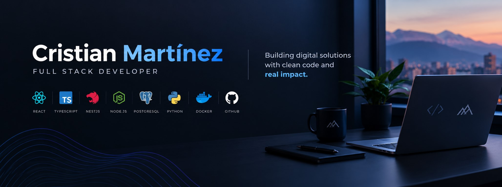

<h1 align="center">Hi, I'm Cristian Martínez</h1>

  Full Stack Developer focused on React, TypeScript and NestJS.

  
  

## 👨‍💻 About Me

I'm a Full Stack Developer and Informatics graduate who builds web applications to solve business problems.

I work across frontend development, backend services, database design and business logic, with experience developing and maintaining software for real-world use.

## 🛠️ Technologies

**Frontend**

**Backend**

**Databases and Infrastructure**

## 🎓 Education

**TSU in Informatics**  
Instituto Universitario Jesús Obrero (IUJO), 2025

## 🤖 AI-Assisted Development

I use AI coding tools to support software development, explore solutions, and improve my workflow while maintaining control over implementation and technical decisions.

## 🌐 Languages

## 📊 GitHub Stats

  

  

